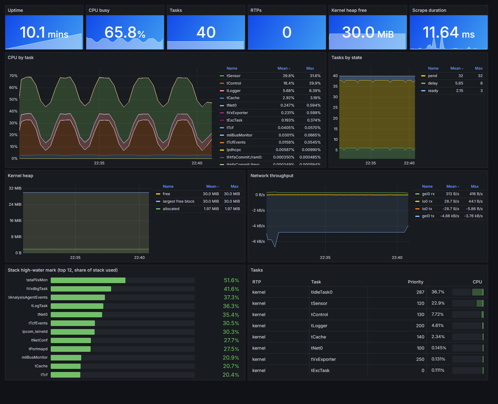

# vxworks_exporter

**A [Prometheus](https://prometheus.io) exporter for [VxWorks 7](https://www.windriver.com/products/vxworks),
Wind River's real-time operating system.**

`node_exporter` serves Linux metrics over HTTP. `vxworks_exporter` does the
same for a VxWorks system: a small kernel module serves `/metrics`, so
Prometheus can scrape the target and Grafana can chart it. You get
per-task CPU time, task states, stack high-water marks, kernel heap usage,
real-time processes (RTPs) and network interface counters.

VxWorks' own tools (`spy`, `i`, `memShow`) print a report to the console
once. They keep no history, and other programs cannot read their output.



*The demo dashboard (`demo/`) with VxWorks running in QEMU. The load comes
from the synthetic demo tasks `tSensor`, `tControl`, `tCache` and `tLogger`.
It illustrates the tool and is not a performance measurement.*

## Quick start

Build the kernel module with the free
[VxWorks SDK](https://forums.windriver.com/t/vxworks-software-development-kit-sdk/43)
(tested with release 26.09 for QEMU x86-64):

```sh
export WIND_HOME=/opt/wrsdk-vxworks7-qemu-1.18.0   # the unpacked SDK
cmake --preset vx-dkm-release
cmake --build --preset vx-dkm-release
# -> build/vx-dkm-release/src/vxworks_exporter.out
```

Load it on the target and start it:

```
-> ld < vxworks_exporter.out
-> vxExporterStart 0, 9100
vxworks_exporter: serving http://<all interfaces>:9100/metrics
```

Then point Prometheus at it:

```yaml
scrape_configs:
  - job_name: vxworks
    static_configs:
      - targets: ["my-target:9100"]
```

To start it at boot, call `vxExporterStart(NULL, 0)` from `usrAppInit()`, or
from a startup script.

## Metrics

| Metric | Type | Labels |
|---|---|---|
| `vxworks_build_info` | gauge, always 1 | `release`, `kernel`, `model` |
| `vxworks_uptime_seconds` | gauge | |
| `vxworks_cpus` | gauge | |
| `vxworks_clock_rate_hz` | gauge | |
| `vxworks_cpu_idle_seconds_total` | counter | `cpu` |
| `vxworks_tasks` | gauge | `state` (ready, pend, delay, suspend, stop, dead, other) |
| `vxworks_task_cpu_seconds_total` | counter | `task`, `task_id`, `rtp` |
| `vxworks_task_priority` | gauge | `task`, `task_id`, `rtp` |
| `vxworks_task_state` | gauge, always 1 | `task`, `task_id`, `state` |
| `vxworks_task_stack_size_bytes` | gauge | `task`, `task_id` |
| `vxworks_task_stack_used_max_bytes` | gauge | `task`, `task_id` |
| `vxworks_kernel_heap_free_bytes` | gauge | |
| `vxworks_kernel_heap_allocated_bytes` | gauge | |
| `vxworks_kernel_heap_allocated_max_bytes` | gauge | |
| `vxworks_kernel_heap_largest_free_block_bytes` | gauge | |
| `vxworks_kernel_heap_free_blocks` | gauge | |
| `vxworks_rtps` | gauge | |
| `vxworks_rtp_tasks` | gauge | `rtp_id`, `path` |
| `vxworks_network_{receive,transmit}_{bytes,packets,errors}_total` | counter | `device` |
| `vxworks_network_receive_drop_total` | counter | `device` |
| `vxworks_network_up` | gauge | `device` |
| `vxexporter_scrapes_total` | counter | |
| `vxexporter_scrape_duration_seconds` | gauge | |
| `vxexporter_cpu_accounting_enabled` | gauge | |
| `vxexporter_cpu_table_overflows_total` | counter | |
| `vxexporter_tasks_truncated` | gauge | |

Notes:

- Task names are not unique in VxWorks, so per-task series also carry
  `task_id`.
- `rtp` is the path of the task's real-time process, or `kernel` for kernel
  tasks.
- Systems that create many short-lived tasks can drop the per-task series with
  `vxExporterPerTask = 0` (from the shell, at any time). The aggregate series
  stay.

Some useful queries:

```promql
# CPU use of each task (0..1 of one CPU)
sum by (task) (rate(vxworks_task_cpu_seconds_total{task!~"tIdleTask.*"}[1m]))

# CPU busy, all CPUs
1 - sum(rate(vxworks_cpu_idle_seconds_total[1m])) / sum(vxworks_cpus)

# Tasks closest to overflowing their stack
topk(10, vxworks_task_stack_used_max_bytes / vxworks_task_stack_size_bytes)
```

## How CPU time is measured

VxWorks has no API that reports CPU time per task: `spy` only prints. The
module therefore counts it itself.

- A task switch hook (`taskSwitchHookAdd`) runs at every context switch. It
  adds the time since the previous switch on that CPU to the task being
  switched out.
- Time comes from the processor's timestamp counter. The module calibrates
  the counter's rate against the system clock when it starts (about 200 ms).
- A task delete hook frees each task's slot when the task ends.
- The hook allocates nothing and takes one spinlock. The table has a fixed
  size (`VXEXP_CPU_TABLE_SLOTS`, default 1024). If it ever fills up,
  `vxexporter_cpu_table_overflows_total` counts the misses.

Interrupt time is charged to the task that was running when the interrupt
arrived, as with any switch-hook accounting. CPU time is counted from
`vxExporterStart()` on. The end-to-end test checks that the CPU time all tasks
accumulate between two scrapes equals the time that passed.

## API

```c
int  vxExporterStart (const char * bindAddr, int port); /* NULL / 0 = all interfaces, 9100 */
int  vxExporterStop  (void);   /* closes the socket, removes the hooks; the module can be unloaded */
void vxExporterShow  (void);   /* prints /metrics to the console */
extern int vxExporterPerTask;  /* 1 (default) or 0 */
extern int vxExporterPriority; /* server task priority for the next start, default 250 */
```

`vxExporterShow` works without a network. It is handy for debugging a target
that Prometheus cannot reach.

Build-time options (CMake cache variables): `VXEXP_DEFAULT_PORT` (9100),
`VXEXP_DEFAULT_PRIORITY` (250), `VXEXP_MAX_TASKS` (2048) and
`VXEXP_CPU_TABLE_SLOTS` (1024).

## Requirements on the target

- VxWorks 7 on x86-64. The CPU-time clock is the x86 timestamp counter. Other
  architectures need a port of `src/module/cpu_accounting.cpp`.
- Kernel components: the loader and symbol table (to load the module), task
  switch and delete hooks (`INCLUDE_TASK_SWITCH_HOOKS`, `INCLUDE_TASK_HOOKS`),
  IPNet sockets, and C++ support in the kernel. The SDK's QEMU kernel has all
  of them.
- The module uses no private kernel APIs. The interface counters come from
  IPNet's routing sysctl (`ipcom_sysctl`, the `NET_RT_IFLIST` dump).

## Demo: Prometheus and Grafana

`demo/` contains a ready-made setup: the synthetic workload module, a script
that boots VxWorks in QEMU with the exporter running, Prometheus, and Grafana
with the dashboard above.

```sh
cmake --preset vx-dkm && cmake --build --preset vx-dkm
python3 demo/run_target.py --build build/vx-dkm --listen 0.0.0.0   # VxWorks in QEMU
docker compose -f demo/docker-compose.yml up                       # Prometheus + Grafana
# open http://localhost:3000
```

The dashboard is generated by `demo/grafana/make_dashboard.py`. Import
`demo/grafana/dashboards/vxworks.json` into any Grafana to use it with real
targets.

## Building and testing

The project uses the layout and tooling of
[vxworks-cpp-template](https://github.com/oguzhankynk/vxworks-cpp-template).
Copy `CMakeUserPresets.json.example` to `CMakeUserPresets.json` to keep the SDK
path out of your shell.

| Preset | What it does |
|---|---|
| `debug`, `release`, `asan`, `tsan`, `coverage`, `tidy`, `cppcheck` | Host builds of the portable core (format writer, HTTP request parser), with its GoogleTest suite |
| `vx-rtp-debug`, `vx-rtp-ubsan` | The same core and tests built for VxWorks and run in QEMU |
| `vx-dkm` | The kernel module. ctest runs its self-test and the end-to-end scrape test in QEMU |
| `vx-dkm-release` | The module to deploy |

- **Self-test** (`tests/dkm/selftest.cpp`): runs on VxWorks and checks 34
  things. Among them: the output is valid exposition text, a busy task
  accumulates CPU time, HTTP routing and status codes work over loopback, and
  stop and restart are clean.
- **End-to-end test** (`tests/e2e/scrape_test.py`): boots VxWorks, starts the
  real module and scrapes it from the host twice. It checks that every family
  is present, that counters never decrease, that CPU time adds up to the
  elapsed time, and that the network counters see the scrape traffic.

`scripts/run_checks.sh --vxworks` runs everything.

## Security

The HTTP server runs in kernel space, so it is deliberately minimal:

- `GET` only, with requests capped at 2 KB;
- receive and send timeouts;
- one connection at a time;
- nothing parsed beyond the request line.

There is no authentication or TLS. Bind it to a management interface
(`vxExporterStart("10.0.0.5", 9100)`) and keep it off untrusted networks.

## Status and roadmap

Early, tested on the VxWorks SDK 26.09 QEMU kernel. Planned:

- per-ISR counts and CPU time;
- RTP memory;
- an optional server that runs as an RTP rather than in the kernel.

See [docs/DESIGN.md](docs/DESIGN.md).

## Licensing notes

This repository contains no Wind River files. You need your own VxWorks SDK
(under Wind River's licence, the SDK's `NCLA.txt`) or a VxWorks installation.
VxWorks and Wind River are trademarks of Wind River Systems, Inc. This project
is not affiliated with or endorsed by Wind River.

MIT licence: see [LICENSE](LICENSE).
